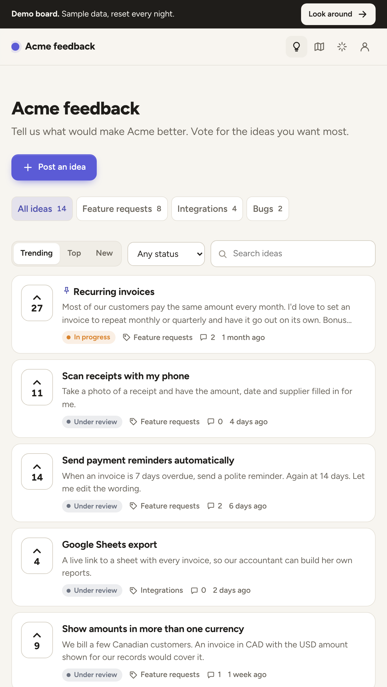

# Feedback board

A feedback board, public roadmap and changelog for your product: customers post ideas and vote on
them, your team sets a status, and when something ships the people who asked for it get an email.
A self-hosted alternative to Canny, Featurebase and Frill, with no per-voter pricing. It runs on
[Whisk](https://whisk.run) as one app.

**Live demo:** https://feedback.examples.whisk.page (press **Look around** to try it as staff)



## Get your own

Copy this one as it is. Give your coding agent this prompt:

> Read https://whisk.run/skill. Clone https://github.com/Whisk-Hosting/feedback-board and put it live on
> my Whisk account as an app called "feedback". Then open it and tell me the address.

Or build your own version from it:

> Read https://whisk.run/skill. Use https://github.com/Whisk-Hosting/feedback-board as a reference and
> build me a feedback board on Whisk for our product, <what it is>. Our customers are <who>. Keep
> its structure and style, and change <what you want different>.

Or by hand, in a copy of this folder:

```
whisk init --name feedback
whisk deploy
```

A new board starts with sample ideas, so it's never empty. Remove them under
**Manage > Settings > Remove sample data**. To let customers sign up by themselves, open
registration for the app in the Whisk dashboard; otherwise invite them with
`whisk customers invite <email>`.

## What it does

- **Ideas.** Customers post an idea with a title, details (Markdown) and a category. While they
  type the title, ideas that look the same appear underneath, so they vote there instead of
  posting a duplicate.
- **Votes.** One per person, toggled in place. Sort by Trending, Top or New; filter by status and
  category; search.
- **Statuses.** Under review, Planned, In progress, Shipped, Closed. Changing one can email
  everyone who follows the idea, with a note.
- **Comments.** Team replies are badged and emailed to followers. Staff notes are only for staff.
  Staff can hide a comment.
- **Roadmap.** Planned, In progress and recently Shipped, most wanted first.
- **Changelog.** Entries labelled New, Improved or Fixed, each linked to the ideas it ships.
  Publishing one moves those ideas to Shipped and emails their followers, once each.
- **Staff tools.** Pin, hide, edit, merge duplicates (votes move across), add a vote for a
  customer by email (it becomes theirs when they sign in), and approve new ideas before they
  show, if you turn that on.
- **Settings.** Board name, tagline, color, time zone and the address email is sent from.
  Dark mode follows the visitor's device.

Who is who: **customers** (the app's own sign-in) post, vote and comment. **Staff** are your
business's team on Whisk: they moderate and write the changelog. **Admins** (owners, admins and
the `feedback-admins` group) also change settings.

## Make it yours

The code is small and plain on purpose. Where to look:

```
src/model.ts       every decision, as pure functions: who may do what, sorting, trending,
                   similar ideas, who gets emailed, merging. Start here.
src/store.ts       one small SQL query per function
src/routes/        the pages and actions: board, ideas, changelog, manage
src/views/         HTML (hono/html, escaped by default), styles.ts, scripts.ts, icons.ts
src/emails.ts      the three emails, as pure functions
src/seed.ts        the sample board
migrations/        plain SQL, run in order before each release
```

- **Statuses**: `STATUSES` and `statusLabel` in `model.ts`, colors in `styles.ts`, and the check
  in a new migration.
- **Look**: the accent color is a setting; everything else is CSS custom properties at the top
  of `styles.ts`.
- **Ranking**: `trendingScore` in `model.ts`.
- **Who may do what**: the `can*` functions in `model.ts`, each tested in `test/model.test.ts`.

## API

Everything staff do on the board, a script or an AI agent can do through `/api/v1`. An admin
makes a key under **Manage > Settings > API keys**; it is shown once and starts with `fb_`.
Send it as `Authorization: Bearer <key>` (Basic auth with the key as the username, `X-Api-Key`
and `?token=` work too). A key acts as staff, so keep it secret; revoke it on the same page.

```
curl "https://<your board>/api/v1/ideas?status=open&sort=top&limit=20" -H "Authorization: Bearer fb_..."

curl -X POST https://<your board>/api/v1/ideas -H "Authorization: Bearer fb_..." \
  -H "Content-Type: application/json" \
  -d '{"title": "Dark mode", "details": "Asked on a call", "category": "features", "author_email": "ana@example.com", "author_name": "Ana"}'

curl -X PATCH https://<your board>/api/v1/ideas/12 -H "Authorization: Bearer fb_..." \
  -H "Content-Type: application/json" -d '{"status": "planned", "comment_value": "Next month"}'

curl -X POST https://<your board>/api/v1/ideas/12/comments -H "Authorization: Bearer fb_..." \
  -H "Content-Type: application/json" -d '{"value": "Thanks, we are on it."}'

curl -X POST https://<your board>/api/v1/changelog -H "Authorization: Bearer fb_..." \
  -H "Content-Type: application/json" \
  -d '{"title": "Dark mode is here", "type": "new", "post_ids": [12], "publish": true}'
```

`GET /api/v1` lists every endpoint: ideas (list, get, post for a customer by email, edit, status,
pin, hide, merge, delete), comments and staff replies, votes, categories, the roadmap and the
changelog. Field names follow Canny's API where it has one. Changes send the same emails the
pages do: a status change emails voters unless `"notify_voters": false`, a team reply emails
followers, and publishing an entry ships its ideas and emails their voters. Lists take
`?limit=` (1 to 200) and `?offset=`, and answer `total` and `next_offset`. Errors are
`{"error": {"code", "message", "fix"}}` with a stable code and status 400, 401, 404, 409 or 422.
On the live demo, Look around and make a key in Settings to try it; the nightly reset removes it.

## How it is built

Hono on Node, Postgres through `postgres`, Markdown through `marked`, server-rendered HTML with
a little JavaScript, no front-end framework. Functional style: decisions are pure functions over
immutable data, and the routes are thin shells that load rows, decide, and store. The build
bundles everything into one file with esbuild, so the app starts fast.

Whisk provides sign-in (`X-Whisk-*` headers), the database, email (`email: true`) and the queue
that sends it (`functions`). People's details and votes are protected by row-level security
(`migrations/0001_feedback.sql`), so a query can never hand one customer another's email.

## Run it locally

With Postgres running:

```
npm install && npm run build
DATABASE_URL=postgres://… node dist/migrate.js
DATABASE_URL=postgres://… PORT=8080 node dist/index.js
```

Without Whisk, emails are logged instead of sent. `whisk dev --as you@example.com --roles owner`
runs it with sign-in too.

## Test it

```
npm test                                   # the rules in model.ts
BASE_URL=http://localhost:8080 npm test    # also a full run through HTTP: post, vote, plan,
                                           # merge, ship, against a local copy
```

## The demo

`demo/whisk.yaml` is the manifest of the live demo: every route public, every change behind a
proof-of-work challenge, and `DEMO=1`, which turns on the **Look around** guest, records emails
without sending them, and resets the sample data every night. It all lives in `src/demo.ts`.
`WHISK_DEMO_APP=<org>/<app> npm run deploy:demo` deploys it. A normal deploy never uses any of it.

## License

MIT
