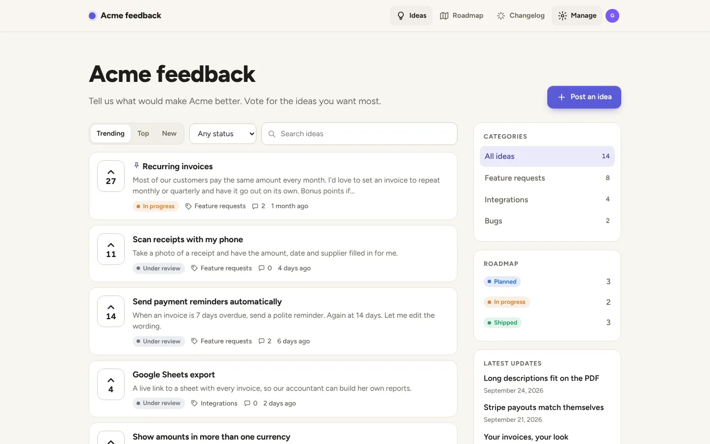
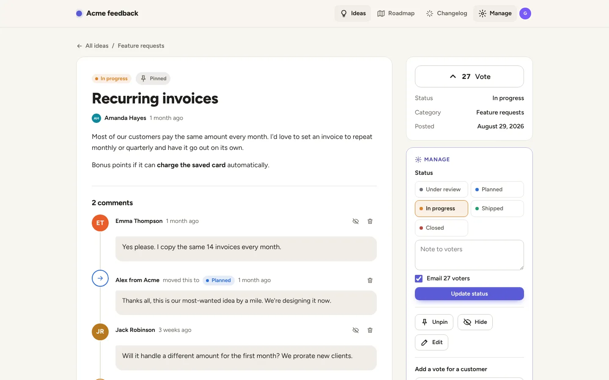
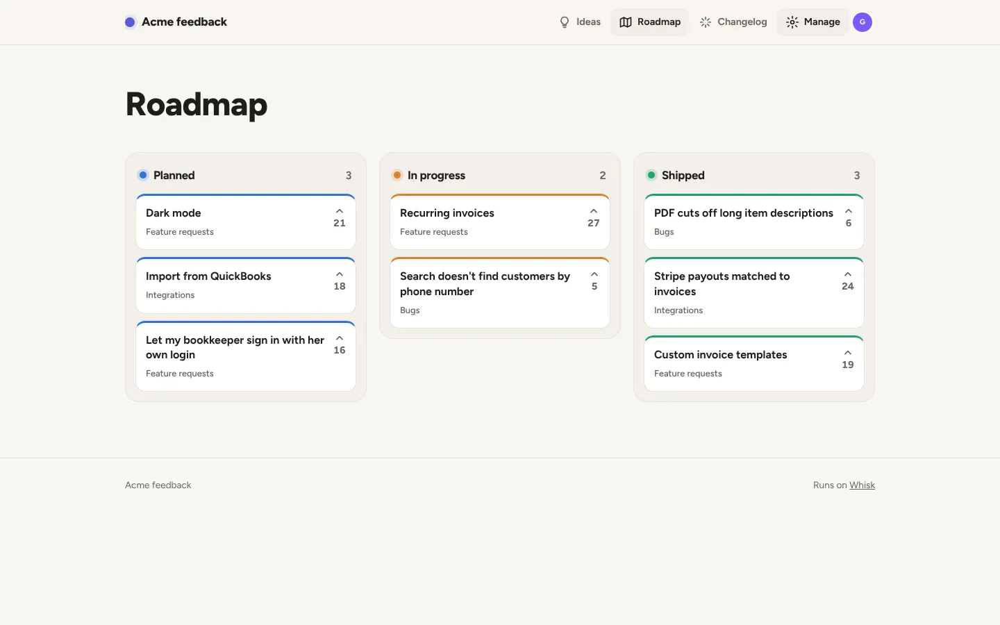
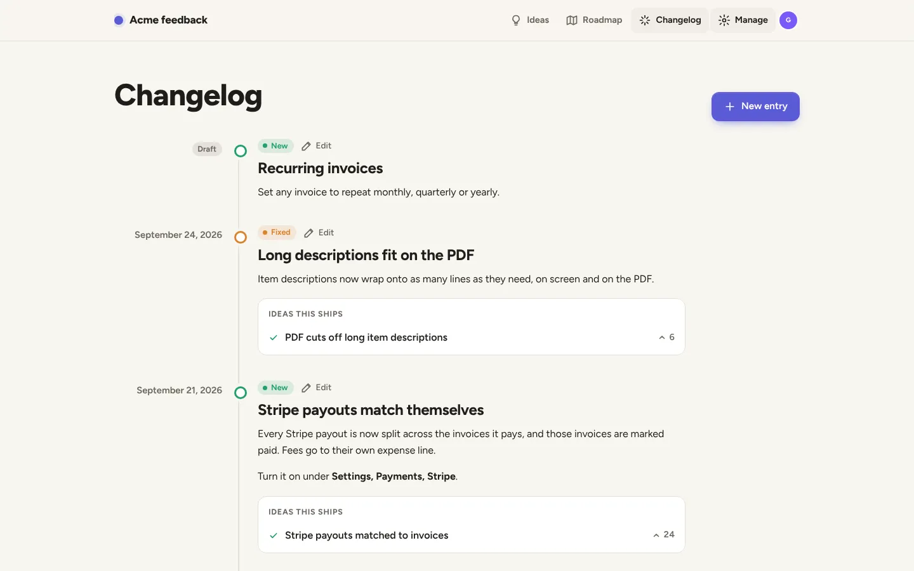
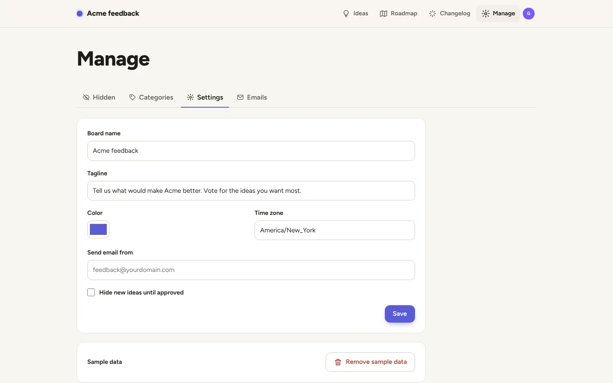
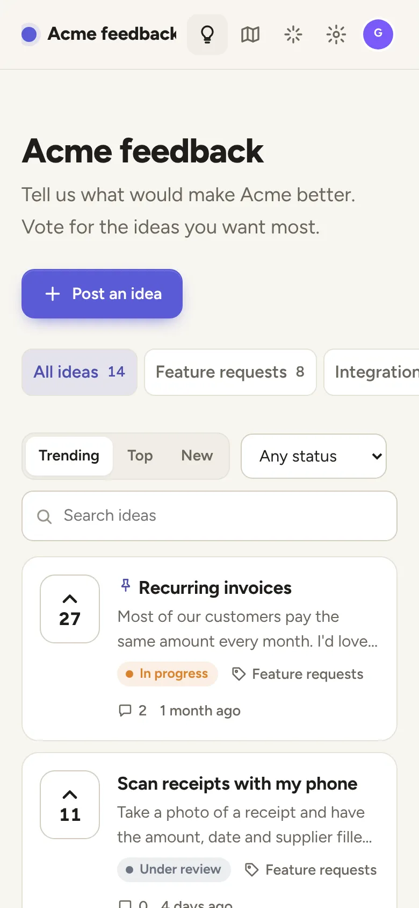
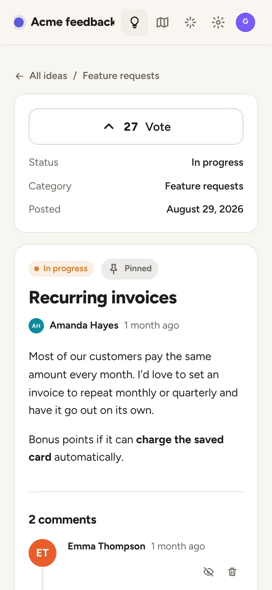

# Feedback board

A feedback board, public roadmap and changelog for your product. Customers post ideas and vote on them, your team sets a status, and when something ships the people who asked for it get an email. It replaces Canny, Featurebase and Frill for most small businesses, with no per-voter pricing.



**[See it live](https://feedback.examples.whisk.page)**. Press **Look around** to use it as staff. It resets every night.

## Deploy your own

Paste this into Claude Code, Codex, Cursor or any coding agent:

> Read https://whisk.run/skill. Then clone https://github.com/Whisk-Hosting/feedback-board, deploy it to Whisk as a new app, and give me its address.

Your agent signs you up to Whisk if you're new, deploys the app, and gives you its address. It comes with sample data so every screen has something to show.

Once it's live, ask your agent to make it yours in plain words, for example:

> Change the name to Maple Street Software, use our logo and our green, and set the time zone to Chicago.

> Add a "Mobile app" category and a "Needs info" status between Under review and Planned.

> Email me whenever a new idea is posted, with a link to it.

Prefer the command line? In a copy of this folder:

```
whisk init --name feedback
whisk deploy
```

To remove the sample ideas, go to **Manage > Settings > Remove sample data**. To let customers sign up by themselves, open registration for the app in the Whisk dashboard; otherwise invite them with `whisk customers invite <email>`.

## What is Whisk?

[Whisk](https://whisk.run) hosts business apps built with AI coding agents. Your agent creates the account, pushes the app, and it's live at its own address with sign-in, a database, backups, scheduled jobs, email and security already taken care of. This app is one of the [Whisk examples](https://whisk.run/examples): open source, MIT licensed, and yours to change.

## Screenshots

<table>
  <tr>
    <td width="50%"><br>An idea, its comments and the staff tools</td>
    <td width="50%"><br>The public roadmap</td>
  </tr>
  <tr>
    <td width="50%"><br>The changelog, linked to the ideas it ships</td>
    <td width="50%"><br>Settings for staff</td>
  </tr>
</table>

<table>
  <tr>
    <td><br>The board on a phone</td>
    <td><br>Voting on a phone</td>
  </tr>
</table>

## Features

- **Ideas.** Customers post an idea with a title, details in Markdown and a category. As they type the title, similar ideas appear underneath, so they vote there instead of posting a duplicate.
- **Votes.** One per person, toggled in place. Sort by Trending, Top or New, filter by status and category, and search.
- **Statuses.** Under review, Planned, In progress, Shipped and Closed. Changing one can email everyone who follows the idea, with a note.
- **Comments.** Team replies are badged and emailed to followers. Staff notes are for staff only, and staff can hide a comment.
- **Roadmap.** Planned, In progress and recently Shipped, most wanted first.
- **Changelog.** Entries labeled New, Improved or Fixed, each linked to the ideas it ships. Publishing one moves those ideas to Shipped and emails their followers, once each.
- **Staff tools.** Pin, hide, edit and merge duplicates (votes move across). Add a vote for a customer by email, which becomes theirs when they sign in. Approve new ideas before they show, if you turn that on.
- **Settings.** Board name, tagline, color, time zone and the address email is sent from. Dark mode follows the visitor's device.
- **API.** Everything staff do, a script or an AI agent can do too, with keys made in Settings.

Who is who: **customers** (the app's own sign-in) post, vote and comment. **Staff** are your business's team on Whisk: they moderate and write the changelog. **Admins** (owners, admins and the `feedback-admins` group) also change settings.

## API

Everything staff do on the board, a script or an AI agent can do through `/api/v1`. An admin
makes a key under **Manage > Settings > API keys**; it is shown once and starts with `fb_`.
Send it as `Authorization: Bearer <key>` (Basic auth with the key as the username, `X-Api-Key`
and `?token=` work too). A key acts as staff, so keep it secret; revoke it on the same page.

```
curl "https://<your board>/api/v1/ideas?status=open&sort=top&limit=20" -H "Authorization: Bearer fb_..."

curl -X POST https://<your board>/api/v1/ideas -H "Authorization: Bearer fb_..." \
  -H "Content-Type: application/json" \
  -d '{"title": "Dark mode", "details": "Asked on a call", "category": "features", "author_email": "ana@example.com", "author_name": "Ana"}'

curl -X PATCH https://<your board>/api/v1/ideas/12 -H "Authorization: Bearer fb_..." \
  -H "Content-Type: application/json" -d '{"status": "planned", "comment_value": "Next month"}'

curl -X POST https://<your board>/api/v1/ideas/12/comments -H "Authorization: Bearer fb_..." \
  -H "Content-Type: application/json" -d '{"value": "Thanks, we are on it."}'

curl -X POST https://<your board>/api/v1/changelog -H "Authorization: Bearer fb_..." \
  -H "Content-Type: application/json" \
  -d '{"title": "Dark mode is here", "type": "new", "post_ids": [12], "publish": true}'
```

`GET /api/v1` lists every endpoint: ideas (list, get, post for a customer by email, edit, status,
pin, hide, merge, delete), comments and staff replies, votes, categories, the roadmap and the
changelog. Field names follow Canny's API where it has one. Changes send the same emails the
pages do: a status change emails voters unless `"notify_voters": false`, a team reply emails
followers, and publishing an entry ships its ideas and emails their voters. Lists take
`?limit=` (1 to 200) and `?offset=`, and answer `total` and `next_offset`. Errors are
`{"error": {"code", "message", "fix"}}` with a stable code and status 400, 401, 404, 409 or 422.
On the live demo, Look around and make a key in Settings to try it; the nightly reset removes it.

## How it's built

Hono on Node, Postgres through `postgres`, Markdown through `marked`, server-rendered HTML with
a little JavaScript, no front-end framework. Functional style: decisions are pure functions over
immutable data, and the routes are thin shells that load rows, decide, and store. The build
bundles everything into one file with esbuild, so the app starts fast.

Whisk provides sign-in (`X-Whisk-*` headers), the database, email (`email: true`) and the queue
that sends it (`functions`). People's details and votes are protected by row-level security
(`migrations/0001_feedback.sql`), so a query can never hand one customer another's email.

### Where to look

The code is small and plain on purpose.

```
src/model.ts       every decision, as pure functions: who may do what, sorting, trending,
                   similar ideas, who gets emailed, merging. Start here.
src/store.ts       one small SQL query per function
src/routes/        the pages and actions: board, ideas, changelog, manage
src/views/         HTML (hono/html, escaped by default), styles.ts, scripts.ts, icons.ts
src/emails.ts      the three emails, as pure functions
src/seed.ts        the sample board
migrations/        plain SQL, run in order before each release
```

- **Statuses**: `STATUSES` and `statusLabel` in `model.ts`, colors in `styles.ts`, and the check
  in a new migration.
- **Look**: the accent color is a setting; everything else is CSS custom properties at the top
  of `styles.ts`.
- **Ranking**: `trendingScore` in `model.ts`.
- **Who may do what**: the `can*` functions in `model.ts`, each tested in `test/model.test.ts`.

## Run it locally

With Postgres running:

```
npm install && npm run build
DATABASE_URL=postgres://… node dist/migrate.js
DATABASE_URL=postgres://… PORT=8080 node dist/index.js
```

Without Whisk, emails are logged instead of sent. `whisk dev --as you@example.com --roles owner`
runs it with sign-in too.

### Test it

```
npm test                                   # the rules in model.ts
BASE_URL=http://localhost:8080 npm test    # also a full run through HTTP: post, vote, plan,
                                           # merge, ship, against a local copy
```

### The demo

`demo/whisk.yaml` is the manifest of the live demo: every route public, every change behind a
proof-of-work challenge, and `DEMO=1`, which turns on the **Look around** guest, records emails
without sending them, and resets the sample data every night. It all lives in `src/demo.ts`.
`WHISK_DEMO_APP=<org>/<app> npm run deploy:demo` deploys it. A normal deploy never uses any of it.

## License

MIT
